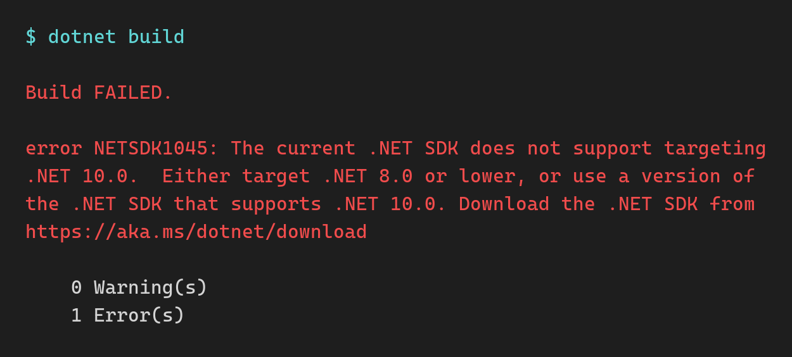
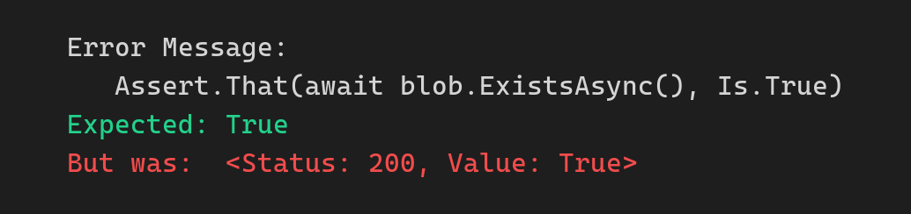

*Read time: 10 minutes*

Last month I moved a production app from .NET 8 to .NET 10, ahead of .NET 8's end of support on Tuesday, November 10.

It's an Azure Functions app that picks up large batch files from an Azure Storage container, processes them, and writes a result file for each one to a separate container. That result file is how you know an input file was processed successfully.

The solution has 3 projects: the app, its unit tests and its integration tests.

The upgrade itself took under an hour. Proving that nothing broke took me a bit over a week.

**Upgrading is the easy part. The hard part is verifying that your app still does exactly what it did yesterday.**

Today I'll go over what changes on Tuesday, the short list of upgrade steps, and the checks that found the problems a green build never showed me.

Let's start.

<br/>

## What happens when .NET 8 support ends?

| Version | Release type | End of support |
|---|---|---|
| .NET 8 | LTS | November 10, 2026 |
| .NET 9 | STS | November 10, 2026 |
| .NET 10 | LTS | November 14, 2028 |

.NET 9 ends on the same day because STS releases now get 24 months of support instead of 18. If you jumped to 9, you're on the same clock.

November 10 is Patch Tuesday. Microsoft says .NET 8 and 9 may each get one final update that day if there's a known critical issue. After that, no more security fixes.

For Azure Functions, the in-process model also reaches end of support that same day.

Your app won't stop. In Microsoft's words, apps "will continue to run". They just run unpatched, and any vulnerability found in .NET 8 after Tuesday stays open in your app.

If you haven't started, you won't finish safely by Tuesday. My move took a bit over a week of verification, plus another week of release process. Skipping the verification to hit the date is the worse trade: an unverified upgrade in production is usually a bigger risk than a few weeks without patches.

<br/>

## Which upgrade steps need attention?

Beyond the TFM bump itself, these are the ones I had to get right.

**The SDK is pinned in 2 places:** your `global.json` and your pipeline. I kept the `global.json` and moved it to a .NET 10 SDK:

```json
{
  "sdk": {
    "version": "10.0.302",
    "rollForward": "latestFeature",
    "allowPrerelease": false
  }
}
```

Deleting it is tempting, but without it the CLI selects the highest installed SDK, and that can change from one build to the next. Installing a specific SDK in CI doesn't by itself control which one gets selected.

The second pin is easier to miss. My pipeline template still had `8.x` as its SDK version, so it would install the .NET 8 SDK, which can't build a `net10.0` project:



<br/>

A quick search of your pipelines for `8.x`, `UseDotNet` (Azure Pipelines) or `setup-dotnet` (GitHub Actions) can catch that before CI does.

**I pinned everything that isn't the runtime.** Targeting `net10.0` brings C# 14 by default, and `AnalysisLevel` defaults to `latest`, so the new SDK also brings new analyzer rules. Both stayed at their .NET 8 values:

```xml
<PropertyGroup>
  <TargetFramework>net10.0</TargetFramework>
  <LangVersion>12.0</LangVersion>
  <AnalysisLevel>8.0</AnalysisLevel>
</PropertyGroup>
```

That way the language and the analyzer rules stay where they were, and only the runtime and its packages move.

The same goes for package majors you don't need. MSTest 4 removes `Assert.ThrowsExceptionAsync`, which the unit tests use, so the unit test project stayed on MSTest 3.x. Test framework majors have their own breaking changes, so I kept that upgrade out of the runtime move.

For Azure Functions, .NET 10 also needs `Microsoft.Azure.Functions.Worker` 2.50.0 or later.

For the ASP.NET Core side of the move, I covered the package versions, CI changes and behavior changes in [The LTS Upgrade: .NET 8 to .NET 10]({{ site.url }}/blog/The-LTS-Upgrade-Dotnet-8-To-Dotnet-10).

<br/>

## Can you trust "upgrade complete"?

I started with [GitHub Copilot upgrade](https://learn.microsoft.com/dotnet/core/porting/github-copilot-upgrade/overview){:target="_blank"}, Microsoft's AI agent for .NET upgrades. It ran its full workflow: assessment, plan, tasks, execution and validation. About half an hour of following its steps.

Its final report said **"Fully completed"**, 3 of 3 tasks done, "production-ready on all safe validation gates".

Yet the app would not even start.

Here's what it validated:

* A clean build, with 0 errors
* The unit tests, matching the .NET 8 baseline
* A vulnerability scan
* A text search confirming the log messages hadn't changed

And here's what it skipped: the integration tests, the full suite, and running the app at all. Its check that the app was ready to run locally was a text search of a config file.

It even said those skipped checks "are not evidence of success or failure". The headline still said production-ready.

These are the failures it didn't catch:

**1. The app crashed on startup.** My local setup ran the app on a .NET install that only had the .NET 8 runtime, and a .NET 10 app can't start without the .NET 10 runtime. The agent moved the app to .NET 10 but never ran it, so it never saw the crash.

**2. Dependency injection failed at startup.** A class asked for `IConfigurationRoot` in its constructor, but only `IConfiguration` was registered. The class was registered and never used anywhere, so for years nothing tried to create it.

The likely trigger was a .NET 9 change to `HostBuilder`: in the Development environment, it now validates DI registrations at startup. `WebApplication.CreateBuilder` already did that, so a typical ASP.NET Core API won't notice.

This app builds its host with `new HostBuilder()`, and the upgrade pulled in `Microsoft.Extensions.Hosting` 10 as a transitive package, so the unused registration finally failed.

The agent's own assessment listed this exact breaking change. It just never started the app to see it happen.

Outside Development, that check is off by default. The bad registration can go unnoticed until something tries to resolve it.

**3. A `MissingMethodException` at runtime.** The agent upgraded one NuGet package to a version incompatible with a related package. Everything compiled, and the app failed when it reached the code that used both.

Packages that ship as a family have to move together, and no tool or Dependabot PR should bump just one of them.

So I opened Claude Code, asked it to find out why the app wouldn't start, and it had the app running in a few minutes.

Both tools made the code changes fast. Neither of them had verified that the app still did its job. That took a bit over a week.

<br/>

## Is your test suite even running?

When I moved the pipeline to .NET 10, I found that the integration tests had never run in CI.

The pipeline had no step that built the integration test project. So the test step found no DLL to run, and reported no failures. Every run was green, and none of them ran a single integration test.

Once I added the build step, the integration tests ran in CI for the first time. 2 of them failed, and 9 more were marked `[Ignore]`. None of that had anything to do with .NET 10. The green pipeline had been hiding it.

The upgrade had also broken something in those same tests: an assertion that could never pass. The Copilot agent had moved the integration tests from the legacy `WindowsAzure.Storage` SDK to `Azure.Storage.Blobs`, and this line came along unchanged:

```csharp
Assert.That(await blob.ExistsAsync(), Is.True);
```

The old `ExistsAsync()` returned `Task<bool>`. The new one returns `Task<Response<bool>>`. The NUnit assertion still compiles, but now it applies `Is.True` to the response object:



<br/>

The blob exists. The test fails anyway. And it was the only check on the step that archives processed files.

The fix is to assert on the value:

```csharp
Assert.That((await blob.ExistsAsync()).Value, Is.True);
```

<br/>

## How do you compare behavior before and after?

A green pipeline after the upgrade proves very little on its own. What I wanted was the same results before and after.

I ran the full suite on .NET 8 and on .NET 10: 284 tests, with 270 passed, 2 failed and 12 skipped on both. Every test kept its outcome.

The result files also had to stay exactly the same. So I built 73 synthetic input files covering every input type the app handles, ran them through both runtimes, and compared the result files byte for byte.

The .NET 8 side ran from a git worktree at the pre-upgrade commit. Flipping the TFM back in place doesn't work once your packages, like EF Core 10, require .NET 10.

<br/>

## How close are your tests to production?

All 73 result files matched byte for byte.

Then the product owner ran their own real production files through QA. The largest one, a 176 MB weekly file, failed.

The cause was a newer version of one of the app's NuGet packages, which came with the upgrade. That version couldn't accept more than about 30 MB of input per job. Production on .NET 8, with the older package, had processed that same file 2 weeks earlier.

Every test file I had was tiny, so nothing hit the limit.

It also looked like a success. The app logged a failure, then logged the run as completed, and wrote no result file and no error file. The input file just sat in its container.

The fix was a patch release of that package, a one-line version bump. Finding it took a real production file.

**Now I test every upgrade with the biggest real production input I can get.**

<br/>

## How do you verify the deployed app?

Tests run on your machine and in CI. A few problems only show up in Azure.

**On Azure App Service and Azure Functions, the .NET version is a setting on the app in Azure, separate from your code.** When the build and that setting didn't match, my app didn't start, and the portal still showed it as Running.

So I changed the runtime setting in the infrastructure as code, deployed the infrastructure first, and deployed the app right after.

**"Running" in the portal proves nothing.** I checked the startup logs and processed a real input end to end to confirm the app worked.

**Your alerts may depend on your log text.** Dozens of production alerts matched words like `COMPLETED` and `FAILED` in the log messages. An upgrade touches a lot of code, and if any change rewords one of those log lines, an alert goes quiet without telling anyone.

So I moved those log messages into constants, with a test that fails the build if one changes.

Then the checks I ran in production:

**Deploy day:**

* The .NET version setting reads 10, and the app started cleanly
* No new exceptions
* A real input processed end to end, with the expected result file

**The next day:**

* Every job that started also completed, with 0 failures
* Durations in line with the previous 2 weeks
* Every alert query that should have results has results

And after that, the largest weekly file completing in production, plus a weekly comparison of volumes, durations and failure rates against the numbers from before the upgrade.

<br/>

## Wrapping up

**The upgrade took under an hour. Proving it took a bit over a week:** a test suite that actually runs, matching test outcomes and result files on both runtimes, the biggest real file you can find, and logs and alerts checked after the deploy.

All the projects in the [bootcamp]({{ site.url }}/courses/dotnetbootcamp) already run on .NET 10, supported until November 14, 2028.

.NET Conf also starts on Tuesday to celebrate the launch of .NET 11. Next Saturday I'll go over whether it's worth the move.

And that's it for today.

See you next Saturday.

<br/>

**Whenever you're ready, here's how I can help:**

**[The .NET Developer Bootcamp]({{ site.url }}/courses/dotnetbootcamp)**: A complete path from ASP.NET Core fundamentals to building, containerizing, and deploying production-ready, cloud-native apps on Azure.
