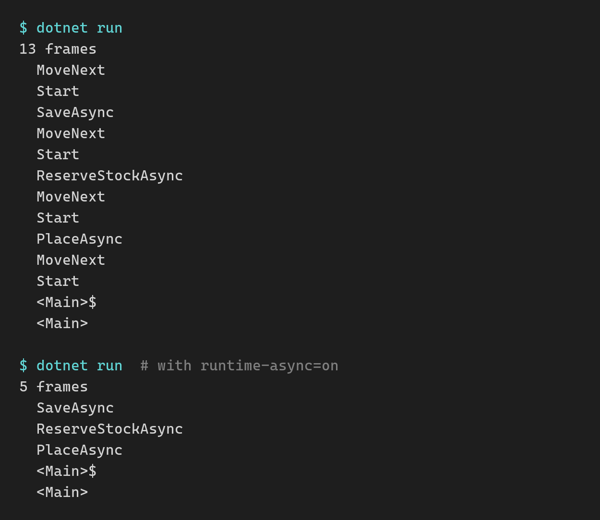

*Read time: 10 minutes*

.NET 11 shipped on Tuesday. It's an STS release, and many teams skip those because they get less support time than an LTS.

That's not the case anymore. .NET 11 is supported until November 14, 2028, the same day as .NET 10.

But [last week]({{ site.url }}/blog/Your-Dotnet-8-App-Stops-Getting-Security-Patches) I wrote about moving a production app to .NET 10. The upgrade took under an hour, and proving that nothing broke took a bit over a week.

**The support time is the same. What .NET 11 costs you is one extra upgrade to verify.**

Today I'll go over what that upgrade costs, the features that could make it worth it, and what changes if you're still on .NET 8 or 9, or starting a new project.

Let's start.

<br/>

## How long is .NET 11 supported?

| Version | Release type | End of support |
|---|---|---|
| .NET 10 | LTS | November 14, 2028 |
| .NET 11 | STS | November 14, 2028 |

.NET 12, the next LTS, is due in November 2027. Whichever version you're on today, you move to .NET 12 before November 14, 2028.

From .NET 10, that's 1 upgrade. If you go to .NET 11 first, it's 2.

<br/>

## What does moving from .NET 10 to .NET 11 cost?

The code change is small. I had Claude Code move the Game Store app from my [bootcamp]({{ site.url }}/courses/dotnetbootcamp) to .NET 11. It has an ASP.NET Core API, a background worker, PostgreSQL through EF Core, Azure Service Bus, Stripe payments, Aspire, and Blazor and React frontends.

It has 23 integration tests that run against PostgreSQL, Service Bus and Azure Storage in Docker containers.

My prompt asked for every package on its latest version, all tests passing, and a pass in the browser over every feature of both frontends.

Claude Code first changed only the target framework to `net11.0` and kept every package where it was. The API, the worker and the tests needed no code changes, there were no new warnings, and all 23 tests passed.

Then it moved every package to its latest version, and found 2 things.

**On PostgreSQL, EF Core stays on version 10.** EF Core 11 is out, but the latest stable Npgsql provider only supports EF Core 10, and as I write this, its 11.0 release is still a release candidate. The app runs on .NET 11 with EF Core 10.0.15, and all 23 tests pass on it.

**A package upgrade broke checkout while every test passed.** The newest Stripe.net rejects webhook events from an older Stripe API version, and my account's events use an older one. Every webhook came back with a 400, so payments went through and no order was created. Claude Code caught it in the browser pass, and staying on Stripe.net 52 fixed it.

That break came from a package upgrade, not from .NET 11. It's the same reason last week I kept the package majors I didn't need out of the runtime move.

The cost is the verification, same as last week.

<br/>

## Which .NET 11 breaking changes should you check first?

.NET 11 has behavior changes that compile with no errors, so a green build won't show them.

These are the 3 I'd check first in a typical API.

### 1. Rounding a double gives different results

`Math.Round` with digits and the cast from `double` to `decimal` are now correctly rounded, so they use the exact value stored in the `double`. This code compiles with no warnings on both versions:

```csharp
double price = 2.675;

Console.WriteLine(
    Math.Round(price, 2, MidpointRounding.AwayFromZero));
Console.WriteLine((decimal)price);
```


<br/>

The `double` 2.675 is stored as 2.67499..., and .NET 11 rounds that value. If a price or a total is stored in a `double` anywhere in your code, it can change by a cent with no error. If you store it as a `decimal` from the start (`2.675m`), it rounds to 2.68 on both versions.

In the Game Store app, every price and total is a `decimal`, so this one didn't apply.

<br/>

### 2. A failing BackgroundService now fails the process

When a worker throws on .NET 10, the host stops, `await host.RunAsync()` returns normally and the process exits with code 0. On .NET 11, `RunAsync` rethrows the worker's exception and the process exits with an error code.

A container that used to exit with 0 now reports a failure, so restart policies and alerts that look at exit codes will react differently.

In the Game Store app, both background services in the worker start a Service Bus processor with no try/catch around it. If that start fails, the worker now exits with an error code instead of 0.

I covered how to keep a worker running while a dependency is down in [How to Build Self-Healing .NET Workers]({{ site.url }}/blog/how-to-build-self-healing-dotnet-workers).

<br/>

### 3. OpenAPI documents now say 3.2.0

The same `AddOpenApi()` call that produced `"openapi": "3.1.1"` on .NET 10 produces `"3.2.0"` on .NET 11. Client generators, API gateways and snapshot tests can all notice. This keeps the document on 3.1:

```csharp
builder.Services.AddOpenApi(options =>
    options.OpenApiVersion = OpenApiSpecVersion.OpenApi3_1);
```

OpenAPI transformers can also stop compiling, because the Microsoft.OpenApi library underneath moved to 3.x. In one of my samples, a transformer that added an example request body failed with CS0200, because `IOpenApiMediaType.Example` is read-only now.

In the Game Store app, the document changed in 2 places: the version line, and the server URL lost its trailing slash. Nothing reads that document, so neither change mattered.

<br/>

### One more if you use Azure SQL

I haven't reproduced this one myself. Microsoft documents that Entra ID authentication for SQL Server moved to a separate `Microsoft.Data.SqlClient.Extensions.Azure` package.

Without it, a connection string with `Authentication=Active Directory Default` fails at runtime. If that's how your app connects to Azure SQL, I'd add that package as part of the move.

<br/>

## Do union types pay for the move?

**Yes, if a `Result` type or a package like OneOf is used all over your codebase.**

A union is a value that can be exactly one of a fixed list of types:

```csharp
public record OutOfStock(string Sku);
public record CustomerNotFound(int Id);

public union OrderResult(Order, OutOfStock, CustomerNotFound);
```

`Order` is the record you already have. It needs no base class and no wrapper.

The service returns one of the 3 types, and each one converts to `OrderResult` implicitly:

```csharp
public OrderResult Place(PlaceOrder cmd)
{
    if (!customers.Exists(cmd.CustomerId))
        return new CustomerNotFound(cmd.CustomerId);

    if (!inventory.InStock(cmd.Sku))
        return new OutOfStock(cmd.Sku);

    return new Order(_nextId++, cmd.CustomerId, cmd.Sku);
}
```

The endpoint switches on that result, and the compiler checks that every case is handled:

```csharp
app.MapPost("/orders", (PlaceOrder cmd, OrderService svc) =>
    svc.Place(cmd) switch
    {
        Order o => Results.Created($"/orders/{o.Id}", o),
        OutOfStock oos => Results.Conflict(new { oos.Sku }),
        CustomerNotFound => Results.NotFound(),
        // no default arm: these are the only cases
    });
```

Then I added a fourth case, `PaymentDeclined`, to the union. The build gave me warning CS8509 at the switch, naming `PaymentDeclined` as the missing case.

Back in February I built a [`Result<T>` class]({{ site.url }}/blog/the-result-pattern) for the same job. Reading it took `result.Value!` and `result.Error!`, plus a `_` arm for error types nobody handled.

The union needs none of that. You only get the `Order` by matching it, and a missing case is a compiler warning. The tradeoff is 1 union per return shape, where `Result<T>` was 1 class for everything.

3 things to watch out for:

* **Value types get boxed.** Microsoft's docs say the generated union "always boxes value-type cases". With records like the ones above, there's nothing to box.
* **A `default` union's value is null.** A `switch` with no `null` arm compiles without a warning, then throws `SwitchExpressionException` at runtime.
* **JSON only works one way for this union.** Serializing writes the active case as plain JSON. Deserializing `OrderResult` throws a `JsonException`, because all 3 cases are JSON objects and the serializer can't tell which one it's reading. If you own all the case types, a `closed` record hierarchy (also new in .NET 11) works both ways once you add `[JsonPolymorphic(InferClosedTypePolymorphism = true)]` to the base record.

**You can't get unions by setting `LangVersion` on .NET 10.** I tried a union in a `net10.0` project with `LangVersion` 15. It fails with CS0518, because the `IUnion` type it depends on only exists in .NET 11.

Microsoft also says that using a C# version newer than the one for your target framework is unsupported.

<br/>

## Does async validation pay for the move?

**Not on its own.**

Validation attributes can be async now. A rule that needs the database runs with the rest of your validation, before the handler:

```csharp
public record CreateUser(
    [Required, EmailAddress, UniqueEmail] string Email,
    [Required] string Name);

public sealed class UniqueEmailAttribute
    : AsyncValidationAttribute
{
    protected override async Task<ValidationResult?>
        IsValidAsync(object? value, ValidationContext context,
            CancellationToken ct)
    {
        var users = context.GetRequiredService<IUserStore>();

        return value is string email
            && await users.EmailExistsAsync(email, ct)
            ? new ValidationResult(
                "That email is already registered.",
                [context.MemberName!])
            : ValidationResult.Success;
    }

    // required override; this rule only runs async
    protected override ValidationResult? IsValid(
        object? value, ValidationContext context) =>
        throw new InvalidOperationException("Async only.");
}
```

With `AddValidation()` registered, the endpoint has nothing left to check:

```csharp
app.MapPost("/users", (CreateUser req) =>
    Results.Created($"/users/{req.Email}", req));
```

If the email is already taken, the endpoint returns a 400 with the message under `Email`. If on top of that you missed the `Name`, both errors come back together:

```json
{
  "title": "One or more validation errors occurred.",
  "status": 400,
  "errors": {
    "Email": ["That email is already registered."],
    "Name": ["The Name field is required."]
  }
}
```

On .NET 10 you'd do that check in the handler or in an endpoint filter. The attribute is cleaner, but it only saves you a few lines per endpoint. I wouldn't upgrade a whole app for that.

You still want a unique index on the email column, though. If 2 requests with the same email arrive at the same time, both can pass the check and both get inserted.

<br/>

## Do the new integration testing APIs pay for the move?

**Not on their own.** They're nice to have once you're there.

.NET 11 adds 2 things for integration tests: a new `ConfigureWebApplicationBuilder` override on `WebApplicationFactory`, and `RemoveDbContext<T>()` in EF Core 11.

```csharp
public sealed class OrdersApiFactory : WebApplicationFactory<Program>
{
    private readonly SqliteConnection _connection =
        new("Data Source=:memory:");

    // runs while Program.cs is still inside CreateBuilder
    protected override void ConfigureWebApplicationBuilder(
        IHostApplicationBuilder builder)
    {
        builder.Configuration.AddInMemoryCollection(
            new Dictionary<string, string?>
            {
                ["Payments:UseSandbox"] = "true"
            });
        base.ConfigureWebApplicationBuilder(builder);
    }

    protected override void ConfigureWebHost(IWebHostBuilder builder)
    {
        _connection.Open();
        builder.ConfigureServices(services =>
        {
            services.RemoveDbContext<OrdersDb>();
            services.AddDbContext<OrdersDb>(o =>
                o.UseSqlite(_connection));
        });
    }
}
```

**`ConfigureWebApplicationBuilder` applies your test configuration before `Program.cs` reads it.** Say your `Program.cs` reads a setting before `Build()`, like this:

```csharp
var builder = WebApplication.CreateBuilder(args);

if (builder.Configuration.GetValue<bool>("Payments:UseSandbox"))
    builder.Services.AddSingleton<IPaymentGateway, SandboxGateway>();
else
    builder.Services.AddSingleton<IPaymentGateway, LiveGateway>();
```

On .NET 10, if your test sets `Payments:UseSandbox` with `ConfigureAppConfiguration`, the value arrives too late and the app registers the live gateway. On .NET 11 it's already there when that `if` runs.

`UseSetting` in `ConfigureWebHost` does get there in time on .NET 10, but it only takes one string value at a time.

**`RemoveDbContext<T>()` removes the app's `DbContext` registration in 1 call.** In [an older post]({{ site.url }}/blog/Dont-Unit-Test-Your-AspNetCore-API) I removed `DbContextOptions<T>` to replace the database. On EF Core 10 that's not enough: the test fails with "Only a single database provider can be registered in a service provider." You have to find the `IDbContextOptionsConfiguration<OrdersDb>` descriptor yourself and remove it.

If you're on PostgreSQL, you'll have to wait for this one. `RemoveDbContext<T>()` comes with EF Core 11, and Npgsql's EF Core 11 provider isn't out yet.

<br/>

## Does runtime async pay for the move?

**Not yet.**

If you've read anything about .NET 11, you've probably seen runtime async. Instead of the compiler turning your `async` methods into state machines, the runtime runs them itself. People often describe it as faster async code for free.

But moving to .NET 11 doesn't turn it on for your code. You have to opt in with 1 line in the project file:

```xml
<Features>runtime-async=on</Features>
```

It's also still a preview feature, according to Microsoft's docs. And in his [performance post](https://devblogs.microsoft.com/dotnet/performance-improvements-in-net-11/){:target="_blank"}, Stephen Toub says the performance goal for .NET 11 "is parity with .NET 10", and that he hopes it'll be on by default starting in .NET 12.

Once you turn it on, what you get today is a much cleaner call stack. I ran a chain of 3 async methods on .NET 11 and captured the stack inside the last one, first without the feature and then with it on:



<br/>

That's 13 frames down to 5, and those 5 are my actual call chain. That shorter stack is also what you'd see in the debugger or a profiler.

The .NET libraries themselves already ship with it on, so their async code runs this way as soon as you upgrade. For my own code, I'd try it on a branch with a profiler open, but I wouldn't upgrade just for it.

<br/>

## What if you're still on .NET 8 or 9?

Support for both ended on Tuesday, and my advice from [last week]({{ site.url }}/blog/Your-Dotnet-8-App-Stops-Getting-Security-Patches) hasn't changed: I'd still go to .NET 10.

You could also go straight to .NET 11. It's 1 upgrade to verify either way, and .NET 11 gives you more for it.

I'd still pick .NET 10, because .NET 11 is so new. You're already running unsupported, .NET 11 is 4 days old, and Microsoft's [list of breaking changes](https://learn.microsoft.com/dotnet/core/compatibility/11){:target="_blank"} for it still says it's "not a complete list". Meanwhile, .NET 10 is on its 15th patch release.

If all you want is to get back to a supported runtime without surprises, I'd take that year of fixes over the new features.

<br/>

## Should a new project start on .NET 11?

**Yes.**

With a new project there's nothing to upgrade, so there's nothing to verify either.

You get the new features, the same end of support as .NET 10, and a shorter jump to .NET 12 later. And by the time your project hits production, .NET 11 will have gotten a few monthly patches.

<br/>

## Wrapping up

**.NET 11 is supported exactly as long as .NET 10, so the only real question is whether its features are worth one extra upgrade.**

If your app is already on .NET 10, I wouldn't move it, unless unions would replace code you have all over the place.

If you're on .NET 8 or 9, .NET 10 is the safer way back to a supported runtime. And if you're starting a new project, I'd start it on .NET 11.

For everything else in .NET 11, check out my [.NET 11 Cheat Sheet]({{ site.url }}/dotnet11), a free PDF that covers 31 features with before and after code, 18 breaking changes and how to fix them, and the upgrade paths from .NET 8, 9 and 10.

And that's it for today.

See you next Saturday.

<br/>

**Whenever you're ready, here's how I can help:**

**[The .NET Developer Bootcamp]({{ site.url }}/courses/dotnetbootcamp)**: A complete path from ASP.NET Core fundamentals to building, containerizing, and deploying production-ready, cloud-native apps on Azure.
