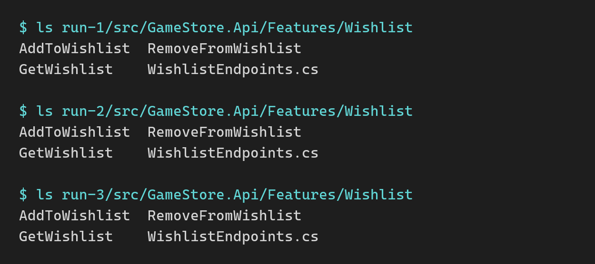

*Read time: 8 minutes*

If you want better .NET code out of Claude Code, the usual advice is to give it better instructions. Write a more detailed prompt, or add a CLAUDE.md that lists your conventions.

But in an existing app, your code is an instruction too. Before Claude Code writes a new feature, it goes and reads how your other endpoints are organized, how they're protected and how they're tested. Then it builds the new one the same way, even if you have no CLAUDE.md at all.

That's great if your codebase already makes good decisions. If it doesn't, Claude copies the problem into every feature it adds, including the things your code leaves out. And you won't catch it in a code review, because each new feature looks just like the rest of your app.

**Claude Code copies what your codebase already does, good or bad. Where there's nothing to copy, Claude decides for you, and the next run can decide differently.**

Today I'll use a real .NET app to show you what Claude copies from a codebase, what it does when your codebase does the same thing in different ways, and what it decides when there's nothing to copy.

Let's start.

<br/>

## How I tested what Claude Code copies

To see how much Claude picks up from the code alone, I used the Game Store app from my [bootcamp]({{ site.url }}/courses/dotnetbootcamp). It has no CLAUDE.md or AGENTS.md, so anything Claude learns about its conventions, it has to learn by reading the code.

I also started every session clean, with no user-level CLAUDE.md, no memory and no MCP servers.

Then I gave Claude Code this prompt 3 times, each time in a fresh copy of the app, to make sure the result wasn't a one-off:

> Add a wishlist to the game store API. Signed-in customers can add a game to their wishlist, remove a game from it, and see their wishlist. Add tests.

It doesn't say where the code goes, how to protect the endpoints or how to test them.

<br/>

## What Claude Code copies from your codebase

Each run took about 4 minutes, and here's the feature folder each one created:



<br/>

All 3 runs came up with the same 3 operations, with the same names, one folder per operation, plus a `WishlistEndpoints.cs` that maps them as a group. That's exactly the [vertical slice]({{ site.url }}/blog/vertical-slice-architecture) layout the existing features use. The `Baskets` feature right next to it has a `GetBasket` folder, an `UpsertBasket` folder and a `BasketsEndpoints.cs` that maps them.

The rest of the feature followed the existing code too:

* `GET /wishlist`, `PUT /wishlist/{gameId}` and `DELETE /wishlist/{gameId}`, with `PUT` for adding, the same way the basket is updated.
* A `WishlistItem` model, an `IEntityTypeConfiguration` class next to the existing ones, and an EF Core migration.
* Integration tests on the existing `GameStoreWebApplicationFactory`, against a real PostgreSQL container, with AutoFixture and Shouldly like the rest of the suite.

I reran the tests from each run myself: 37, 35 and 38 tests passing, with 12 to 15 new ones in each.

Then there's security. None of the 3 runs added a single `.RequireAuthorization()` call to the new endpoints. They didn't need one, because the API already has a fallback policy:

```csharp
builder.Services.AddAuthorizationBuilder()
                .AddFallbackPolicy(Policies.UserAccess, authBuilder =>
                {
                    authBuilder.RequireClaim(GameStoreClaimTypes.Scope, ApiAccessScope);
                })
                .AddPolicy(Policies.AdminAccess, authBuilder =>
                {
                    authBuilder.RequireClaim(GameStoreClaimTypes.Scope, ApiAccessScope);
                    authBuilder.RequireRole(Roles.Admin);
                });
```

With this in place, any endpoint that doesn't declare its own authorization requires a signed-in user with the API scope. So the wishlist was protected the moment it was mapped. (I covered this policy in [Fixing Claims the Right Way]({{ site.url }}/blog/fixing-claims-the-right-way).)

Claude knew the policy was there, too. All 3 runs wrote tests for a caller with no token (401) and a token without the API scope (403), and run 2 even left a comment in `WishlistEndpoints.cs` explaining why there was nothing to add:

```csharp
// The wishlist always belongs to the signed-in customer, so routes don't
// take a user id. Authentication is enforced by the fallback policy.
```

Remember, the prompt only said signed-in customers. It didn't say how to enforce that, and the fallback policy already did, so none of the runs added anything to require a signed-in user.

<br/>

## Claude Code copies what your codebase leaves out

Here's something the Game Store app doesn't do: none of its endpoints take a `CancellationToken`. So none of the 9 new endpoints across the 3 runs take one either, and not one of the 3 final reports mentions it.

That means if a client disconnects halfway through a request, the database query keeps running anyway. On a wishlist, that's not a big deal.

And good luck spotting that in a diff. A missing parameter doesn't show up as a changed line, so you'd only catch it if you already knew it should be there.

So whatever your existing endpoints skip, the new ones Claude writes will most likely skip too.

<br/>

## What Claude Code does when your codebase does the same thing in different ways

The next decision is harder to spot. The Game Store app checks who owns something in 2 different ways.

The `/orders` endpoints read the customer id straight from the signed-in user's token:

```csharp
var userIdClaimValue = user.FindFirstValue(GameStoreClaimTypes.UserId);

if (!Guid.TryParse(userIdClaimValue, out var userId))
{
    return Results.Forbid();
}
```

The `/baskets/{userId}` endpoints take the id from the route instead, load the basket, and run a resource-based authorization check that allows access only to the basket's owner or an admin:

```csharp
var authResult = await authorizationService.AuthorizeAsync(
    user,
    basket,
    new OwnerOrAdminRequirement()
);
```

Which one did Claude pick? `/orders`, in all 3 runs. Every wishlist endpoint starts with the same check:

```csharp
if (!Guid.TryParse(user.FindFirstValue(GameStoreClaimTypes.UserId), out var userId))
{
    return Results.Forbid();
}
```

That's a reasonable choice. With no id in the URL, a customer can only see their own wishlist.

But it also means an admin has no way to look at a customer's wishlist. `GET /wishlist` always returns the wishlist of whoever is signed in. With baskets, an admin can call `/baskets/{userId}` with any customer's id, and the owner-or-admin check allows it.

If your support team ever needs to look at a wishlist, that's a different design.

Only run 2 told me about it in its final report:

> As a result, admins can't view another customer's wishlist. That would be a small addition if you want it.

Runs 1 and 3 explained why one customer can't see another's wishlist, and never mentioned admins.

So in 2 of the 3 runs, Claude made that call without mentioning it. To catch it, you'd have to know both patterns exist in your codebase, and what each one allows.

Meanwhile, the app now checks ownership one way in 2 features and another way in 1. And the more features Claude adds this way, the more code you'll have to change if you ever want them all to check ownership the same way.

<br/>

## What Claude Code decides when there's nothing to copy

Now, what happens when there's no codebase at all? That's where you are every time you start a new project with Claude Code.

To find out, I took the codebase away. Same model, same settings, an empty folder, and this prompt:

> Build a .NET 10 Web API for an online game store.
>
> - Anyone can browse and search the games catalog.
> - Admins can add, update and delete games.
> - Signed-in customers have a shopping basket and can place an order from it. Placing an order creates the order and empties the basket. Customers can see their orders.
>
> Use minimal APIs, EF Core with PostgreSQL, and JWT bearer authentication against Keycloak. Use Aspire to run everything locally. It will be deployed to Azure Container Apps with Azure Database for PostgreSQL, and it needs to be production ready. Add tests.

It asks for the same catalog, basket and orders the Game Store app already has, just with no code to start from. And just like the wishlist prompt, it says who can do what, but nothing about how to enforce it.

I ran it twice. Run 1 took 16 minutes and run 2 took 36. Both apps built cleanly, and when I reran their tests, all 60 and all 39 passed.

Run 1 decided to protect every endpoint by default:

```csharp
// Secure by default: endpoints must explicitly opt in to anonymous access.
.SetFallbackPolicy(new Microsoft.AspNetCore.Authorization.AuthorizationPolicyBuilder()
    .RequireAuthenticatedUser()
    .Build());
```

Run 2 went the other way. No fallback policy, and each route group protects itself:

```csharp
var group = app.MapGroup("/basket")
    .WithTags("Basket")
    .RequireAuthorization(Policies.Customer)
    .RequireRateLimiting(RateLimitingExtensions.PerClientPolicy);
```

Both apps pass their tests, and both do what the prompt asked. You won't see the difference until somebody adds the next endpoint.

In run 1, that endpoint is protected until someone makes it public. In run 2, it's public until someone remembers to add `.RequireAuthorization()`.

Same prompt, same model, and a different security default each time. And unless you know what a fallback policy does, you won't notice which one you got when you review the code.

There's more. Both runs also made these 5 decisions that the prompt never mentioned:

* They turned off inbound claim mapping (`MapInboundClaims = false`), so token claims keep their short JWT names like `sub`.
* They require a token audience of `gamestore-api`, which Keycloak only issues once you add an audience mapper to the realm.
* Aspire runs Keycloak only locally. In Azure, the API expects the URL of a Keycloak realm hosted somewhere else.
* The API signs in to Azure Database for PostgreSQL with its managed identity, so there's no database password.
* Placing an order saves the order and empties the basket in one transaction.

All 5 are good choices. But Claude made each one because there was nothing in the folder to copy, and 2 of them need work outside the code before you deploy: an audience mapper in your Keycloak realm, and a production Keycloak for the API to point at.

<br/>

## Wrapping up

**Claude Code copies what your codebase already does, good or bad. Where there's nothing to copy, Claude decides for you, and the next run can decide differently.**

The usual advice is to give Claude better instructions. But the wishlist runs had no CLAUDE.md and a prompt that said nothing about how to build the feature, and Claude still built the feature the way the code already did, gaps included.

Vertical slices, the fallback policy, the owner-or-admin check, managed identities and integration tests are all things my [bootcamp]({{ site.url }}/courses/dotnetbootcamp) walks you through while building the Game Store app.

Once those are right in your own codebase, every feature Claude adds will copy them too.

And that's it for today.

See you next Saturday.

<br/>

**Whenever you're ready, here's how I can help:**

**[The .NET Developer Bootcamp]({{ site.url }}/courses/dotnetbootcamp)**: A complete path from ASP.NET Core fundamentals to building, containerizing, and deploying production-ready, cloud-native apps on Azure.
