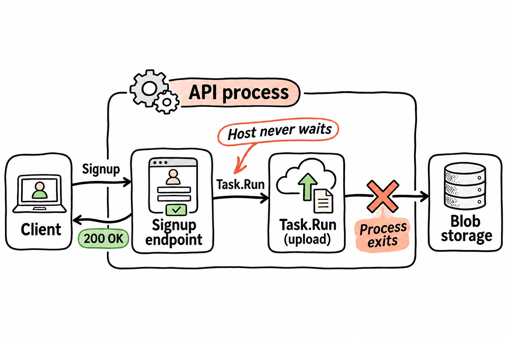
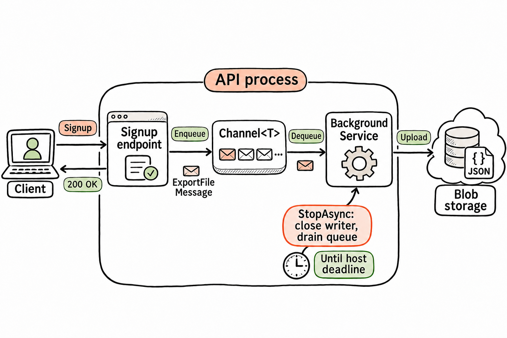
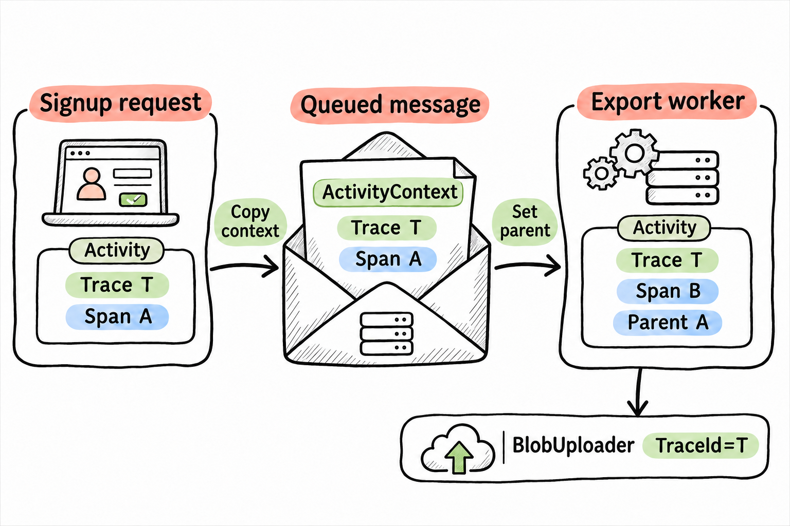
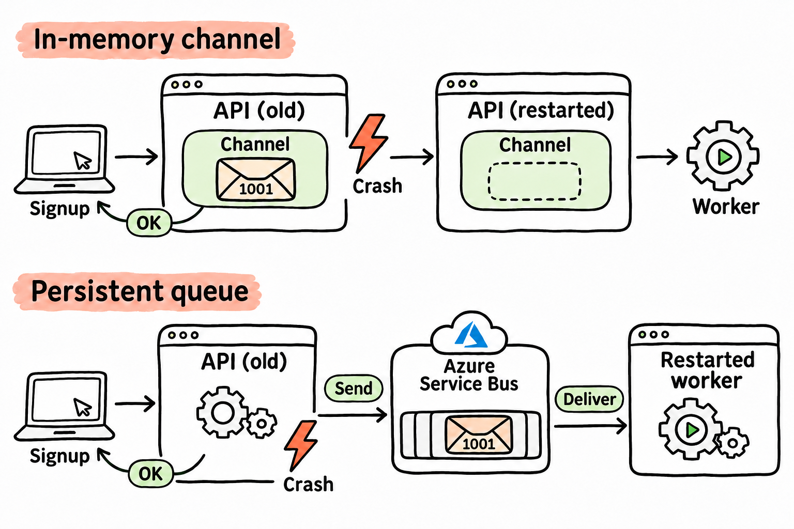

*Read time: 9 minutes*
<p style="text-align: center; font-size: 1.2em;"><strong>The .NET Saturday is brought to you by:</strong></p>

<div style="background: linear-gradient(90deg, #e0eafc 0%, #cfdef3 100%); padding: 36px; margin: 24px 0; overflow: hidden; border-radius: 14px; box-shadow: 0 2px 12px rgba(80,120,200,0.08);">
  <a href="https://www.devart.com/blackfriday.html?utm_source=juliocasal.com&utm_medium=referral&utm_campaign=cc_bf_26_newsletter_juliocasal.com" target="_blank"></a>

  <p style="margin: 0 0 18px 0;"><strong>Build Better .NET Apps with PostgreSQL This Black Friday</strong></p>

  <p style="margin: 0 0 18px 0;">Working with PostgreSQL and EF Core? Devart's <a href="https://www.devart.com/dotconnect/postgresql/?utm_source=juliocasal.com&utm_medium=referral&utm_campaign=cc_bf_26_newsletter_juliocasal.com" target="_blank">dotConnect for PostgreSQL</a> simplifies database access with .NET 11 support, advanced ADO.NET features, and compatibility with EF Core and Dapper, helping you focus on building applications.</p>

  <p style="margin: 0 0 18px 0;">And PostgreSQL is just the beginning. <a href="https://www.devart.com/dotconnect/?utm_source=juliocasal.com&utm_medium=referral&utm_campaign=cc_bf_26_newsletter_juliocasal.com" target="_blank">Devart offers 20+ data connectors</a> for different databases and data sources.</p>

  <p style="margin: 0 0 18px 0;">This Black Friday, <strong>save up to 40%</strong> on selected Devart developer tools!</p>

  <div style="display: flex; justify-content: center;">
    <a href="https://www.devart.com/blackfriday.html?utm_source=juliocasal.com&utm_medium=referral&utm_campaign=cc_bf_26_newsletter_juliocasal.com" target="_blank" style="background: linear-gradient(90deg, #4f8cff 0%, #235390 100%); color: #fff; padding: 14px 36px; border-radius: 8px; text-decoration: none; font-weight: 600; font-size: 1.1em; box-shadow: 0 2px 8px rgba(80,120,200,0.10); transition: background 0.2s; text-align: center;">Explore Devart Black Friday Deals</a>
  </div>
</div>

If your API has work your users shouldn't have to wait for, and it's not worth adding a persistent queue for it, the lightest option in ASP.NET Core is an in-memory queue: a `Channel<T>` and a `BackgroundService` that reads from it. Microsoft's docs have a sample for it, and you'll find plenty of posts that show the same thing.

This month I moved some work in a production API to one of those queues. After each signup, the API writes a small JSON file to blob storage for another team, and that upload used to run in a fire-and-forget `Task.Run` right inside the endpoint.

But 2 things came up that the samples don't cover.

First, the request IDs disappeared from the log lines the background work writes. And second, a queue written like the sample in Microsoft's docs loses its queued work on shutdown, just like that `Task.Run` did.

**An in-memory queue comes with 3 decisions the samples skip: what travels in the message, what happens to the queue when the app stops, and what happens to it when the process dies.**

Today I'll show you the queue, why the request IDs disappeared, how to keep the queue from losing work on shutdown, and what to do when the work can't be lost.

Let's start.

<br/>

## What's wrong with a Task.Run that never failed?

Here's what the endpoint looked like, trimmed down to the part that matters:

```csharp
app.MapPost("/signups", async (SignupRequest request, SignupService signups, ExportFileService exportFiles) =>
{
    var customer = await signups.CreateAsync(request);

    _ = Task.Run(() => exportFiles.CreateExportFile(customer));

    return Results.Ok(customer);
});
```

The upload takes about half a second, and there's no reason to make the person signing up wait for it. So it goes into a `Task.Run` that nobody awaits.

And it worked fine. In the last 30 days of production logs, not a single one of those uploads failed.

The problem is the host has no idea that task exists. When the app shuts down, the host waits for any requests still in flight, and for its hosted services. A task you started with `Task.Run` is neither, so nobody waits for it.



<br/>

To see what that looks like, I sent 3 signups to the endpoint and stopped the app right after the third one:


<br/>

The process was gone 24 ms after the stop request, with exit code 0, and none of the 3 files got written. And there's no error to look for either, because the uploads never got far enough to fail.

Now, that API runs on Kubernetes, and every deploy stops the running pods. So any deploy can drop the files for whoever signed up right before it.

And those 30 clean days of logs? They can't tell me if that ever happened, because a file lost this way doesn't log anything.

<br/>

## Moving the work to a channel and a BackgroundService

The replacement has 3 pieces: a message, a queue that wraps a `Channel<T>`, and a `BackgroundService` that reads from it. Here are the first 2:

```csharp
public sealed record ExportFileMessage(Customer Customer);

public sealed class ExportFileQueue
{
    private readonly Channel<ExportFileMessage> channel =
        Channel.CreateUnbounded<ExportFileMessage>();

    public ChannelReader<ExportFileMessage> Reader => channel.Reader;

    public bool Enqueue(ExportFileMessage message) =>
        channel.Writer.TryWrite(message);

    public void Complete() => channel.Writer.TryComplete();
}
```

The message is just plain data. It has everything the worker needs to write the file, and nothing that belongs to the request.

[Microsoft's sample](https://learn.microsoft.com/dotnet/core/extensions/queue-service){:target="_blank"} queues a `Func<CancellationToken, ValueTask>` instead. The trouble with a lambda is that it can capture whatever is around it, including services that get disposed as soon as the request ends. So I'd rather queue a record.

The channel is unbounded. `Task.Run` never turned work away either, and with a few dozen files a day, this queue sits empty almost all the time.

With that, all the endpoint does is put a message on the queue:

```csharp
app.MapPost("/signups", async (SignupRequest request, SignupService signups, ExportFileQueue queue) =>
{
    var customer = await signups.CreateAsync(request);

    queue.Enqueue(new ExportFileMessage(customer));

    return Results.Ok(customer);
});
```

And the worker writes 1 file per message:

```csharp
public sealed class ExportFileWorker(
    ExportFileQueue queue,
    IServiceScopeFactory scopeFactory,
    ILogger<ExportFileWorker> logger) : BackgroundService
{
    protected override async Task ExecuteAsync(CancellationToken stoppingToken)
    {
        await foreach (var message in queue.Reader.ReadAllAsync())
        {
            try
            {
                await using var scope = scopeFactory.CreateAsyncScope();
                var writer = scope.ServiceProvider.GetRequiredService<ExportFileWriter>();
                await writer.WriteAsync(message.Customer);
            }
            catch (Exception ex)
            {
                logger.LogError(ex, "Export file not written for {CustomerNumber}", message.Customer.Number);
            }
        }
    }
}
```

The worker also has a `StopAsync`, and that's where the queue's `Complete()` gets called. I'll get to both in a minute, when we talk about shutdown.



<br/>

There are 2 details in that loop that are easy to get wrong.

**It creates a new scope for every message.** A hosted service is a singleton, so you can't inject scoped services like a `DbContext` into its constructor. With a scope per message, each file gets its own fresh instances, just like each request does.

**The `try/catch` is inside the loop.** By default, if an exception escapes `ExecuteAsync`, the host stops the entire app. And I don't want one bad file to take down the whole API. I covered what that does to the process in [.NET 11 vs .NET 10]({{ site.url }}/blog/Dotnet-11-vs-Dotnet-10-Is-It-Worth-The-Move).

<br/>

## Why did the request IDs disappear from the logs?

Whether it runs in the `Task.Run` or in the worker, the actual upload happens in a `BlobUploader` class, which logs a line after each file it uploads. After the change, I compared that line before and after. Here's what it looked like with `Task.Run`:

```text
info: BlobUploader[0]
      => SpanId:f7a6247bbf8d8520, TraceId:d60312a60cd37e27d22bedbabc9016db, ParentId:0000000000000000 => ConnectionId:0HNQ94Q3JHDIF => RequestPath:/signups RequestId:0HNQ94Q3JHDIF:00000001
      File signup_1001.json uploaded
```

That line was written after the response had already gone out, and it still has the request's trace ID, connection ID, request ID and path.

That's because `Task.Run` copies the caller's execution context into the new task, and that context is where the request's logging scopes and its current `Activity` live.

Here's the same line from the worker:

```text
info: BlobUploader[0]
      File signup_1001.json uploaded
```

No scopes at all. The worker's loop started once, back when the app started, outside of any request. The only thing it ever gets from a request is the message.

Now if I search the logs for a signup's trace ID, the upload isn't there anymore.

Anything the worker's logs need has to travel in the message, so I added the request's trace context to it:

```csharp
public sealed record ExportFileMessage(Customer Customer, ActivityContext Parent);
```

```csharp
queue.Enqueue(new ExportFileMessage(customer, Activity.Current?.Context ?? default));
```

Then the worker restores it before writing the file:

```csharp
private async Task WriteFileAsync(ExportFileMessage message)
{
    using var activity = message.Parent == default
        ? null
        : new Activity("Export file write")
            .SetParentId(message.Parent.TraceId, message.Parent.SpanId, message.Parent.TraceFlags)
            .Start();

    using var logScope = logger.BeginScope(
        "CustomerNumber:{CustomerNumber}", message.Customer.Number);

    await using var scope = scopeFactory.CreateAsyncScope();
    var writer = scope.ServiceProvider.GetRequiredService<ExportFileWriter>();
    await writer.WriteAsync(message.Customer);
}
```



<br/>

The new `Activity` continues the request's trace, so the line gets the request's trace ID back, and its `ParentId` is the request's span. And the logging scope adds the customer number:

```text
info: BlobUploader[0]
      => SpanId:d3b55a5ec18f644f, TraceId:7430b8812564b5eb4579c75095bf52d5, ParentId:de7e216beb756858 => CustomerNumber:1001
      File signup_1001.json uploaded
```

I didn't bring back the request ID, the path or the connection ID. None of our queries use them on these lines.

If this sounds familiar, it's the same idea as following a request through a Service Bus queue, which I covered in [The Missing One-Liner for Azure Service Bus Tracing]({{ site.url }}/blog/the-missing-one-liner-for-azure-service-bus-tracing-with-dotnet-aspire).

<br/>

## Does the queue drain when the app stops?

It depends on what your worker does with the stopping token.

Here's the loop from the queue service sample in Microsoft's docs, where `DequeueAsync` reads from a channel:

```csharp
while (!stoppingToken.IsCancellationRequested)
{
    try
    {
        Func<CancellationToken, ValueTask>? workItem =
            await taskQueue.DequeueAsync(stoppingToken);

        await workItem(stoppingToken);
    }
    catch (OperationCanceledException)
    {
        // Prevent throwing if stoppingToken was signaled
    }
    catch (Exception ex)
    {
        logger.LogError(ex, "Error occurred executing task work item.");
    }
}
```

When the host shuts down, it cancels `stoppingToken`. This loop checks that token on every iteration and passes it to the work item too, so the file being written gets cancelled and whatever is still queued never starts.

I put that same loop in a small test app that queues 5 files and stops the app while the first one is being written, 20 times. Then I ran the same test against my worker:


<br/>

The sample's loop lost files in every single run. My worker wrote all 100.

That's because my worker never looks at the stopping token. Its loop calls `ReadAllAsync()` with no token, and shutdown goes through its own `StopAsync`:

```csharp
public override async Task StopAsync(CancellationToken cancellationToken)
{
    queue.Complete();

    if (ExecuteTask is { } executeTask)
    {
        await executeTask.WaitAsync(cancellationToken)
            .ConfigureAwait(ConfigureAwaitOptions.SuppressThrowing);
    }
}
```

* **It completes the channel.** So nothing new gets in, and `ReadAllAsync()` ends once the loop has written whatever is left.
* **Then it waits for the loop, but only for as long as the host allows.** When the host's shutdown timeout runs out, it cancels that token, and `SuppressThrowing` turns that cancellation into a normal return.

It doesn't call `base.StopAsync` either. On .NET 10, that cancels the stopping token, and if it happens before `ExecuteAsync` has started, the loop never runs and the files stay in the channel.

<br/>

## What if the work can't be lost?

Draining only helps when the app stops cleanly. If the process crashes, runs out of memory, or the pod gets killed, everything in the channel is gone. It only ever existed in that process's memory.

For this feature, we stayed with the in-memory queue. It's a few dozen files a day, and there wasn't a single failed upload in a month.

What we did add is a way to find out when a file gets lost. The API logs a line when it queues a file, and the worker logs one when the file is written or when it fails. Then an alert looks for any file that was queued and still has neither of those 5 minutes later.

If your work can't be lost, it has to be saved somewhere that outlives the process before the request returns. That can be a row in an outbox table, saved in the same transaction as the rest of your data, or a message in a queue like Azure Service Bus.

Then a worker picks it up from there. If the process dies halfway, the row or the message is still there waiting when the next one starts. I covered the outbox in [Stop Losing Messages: Implement the Outbox Pattern in .NET]({{ site.url }}/blog/stop-losing-messages-implement-the-outbox-pattern-in-dotnet).



<br/>

The Game Store app in my [bootcamp]({{ site.url }}/courses/dotnetbootcamp) works exactly that way: an outbox table, a Service Bus queue and a worker that reads from it. There's nothing to drain on shutdown there, because whatever didn't get processed is still in the database or in the queue.

<br/>

## Wrapping up

**An in-memory queue comes with 3 decisions the samples skip: what travels in the message, what happens to the queue when the app stops, and what happens to it when the process dies.**

The worker starts outside of any request, so the message has to carry whatever log context the worker needs. And whether the queue drains on shutdown depends on what the worker does with the stopping token.

But no matter how well it drains, an in-memory queue still loses everything on a crash. If your feature can't afford that, the work has to be stored outside the process before the request returns.

And that's it for today.

See you next Saturday.

<br/>

**Whenever you're ready, here's how I can help:**

**[The .NET Developer Bootcamp]({{ site.url }}/courses/dotnetbootcamp)**: A complete path from ASP.NET Core fundamentals to building, containerizing, and deploying production-ready, cloud-native apps on Azure.
